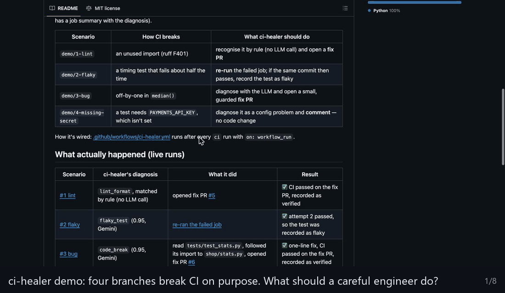

# ci-healer 🩺

**Self-healing CI for GitHub Actions.** When a workflow run fails, ci-healer reads the logs,
works out *what kind* of failure it is, and does the right thing:

| Failure | What ci-healer does |
|---|---|
| Infra / network blip (runner died, registry 503, DNS…) | Re-runs the failed jobs once |
| Flaky test | Re-runs once, and **remembers** — if the rerun of the same commit passes, that test is recorded as flaky and recognised next time |
| Lint / format / trivial break | Opens a small **fix PR** — only if it passes every guardrail. For a failing test it first reads (never runs) the modules the test imports, so an off-by-one in `shop/stats.py` is found from `tests/test_stats.py` |
| Real bug, config problem, anything risky | Explains the diagnosis (job summary / PR comment) and leaves it to you |

Classification is cheap-first: known error signatures are matched by rules (free), and only the
rest goes to an LLM — Anthropic, Gemini, Groq, OpenAI, OpenRouter, Mistral, DeepSeek, Together,
Ollama, or any OpenAI-compatible endpoint.

**On the Marketplace:** [marketplace/actions/ci-healer](https://github.com/marketplace/actions/ci-healer),
or search "ci-healer" from any repo's Actions tab and click *Use this action*.

**See it live:** [TSRCHARAN/ci-healer-demo](https://github.com/TSRCHARAN/ci-healer-demo) has
branches that break on purpose and the PRs ci-healer opened for them.



*Prefer a voice-over? [Two-minute narrated video](https://github.com/TSRCHARAN/ci-healer/releases/download/v1.0.7/demo.mp4) (MP4, 3 MB).*

## Use it as a GitHub Action

Setup is one secret, one setting and one file. Nothing to host, no account with us: it runs
on your repo's own GitHub Actions runners.

1. **Get an LLM key** from the provider you want to use (Google AI Studio for Gemini, Groq,
   Anthropic, OpenAI, …). This is the only thing you create outside GitHub.
2. **Store the key in your repo:** Settings → Secrets and variables → Actions → *New repository
   secret*, named `LLM_API_KEY`. Only the key is secret; the provider and model names are not
   sensitive and go straight in the workflow file.
3. **Let Actions open PRs:** Settings → Actions → General → Workflow permissions → tick
   *Allow GitHub Actions to create and approve pull requests*. It is off by default; without it
   ci-healer can diagnose but cannot open a fix PR.
4. **Add the workflow:** copy [examples/ci-healer.yml](examples/ci-healer.yml) to
   `.github/workflows/ci-healer.yml`, set `workflows: ["<your CI workflow name>"]`, and set
   `llm-provider` / `llm-model` to match your key. Commit it. Setup is done.
5. **Watch it in shadow mode for a week or two.** The example starts with `dry-run: "true"`:
   on every CI failure ci-healer reads the log, asks the LLM, and decides what it *would* do,
   but changes nothing: no re-run, no PR, no comment. Its report is the **job summary** of the
   ci-healer run (Actions tab → *ci-healer* workflow → the run → Summary), with the category,
   confidence, evidence from the log and, for a fix, the exact diff it would have opened. The
   LLM key is used in this mode, so it costs the same tokens as live.
6. **Switch it on** when the verdicts look right: change `dry-run` to `"false"`. From then on a
   flaky test or infra blip is re-run once, a lint error or small obvious bug gets a fix PR, and
   everything else gets a diagnosis and no change. You still review and merge every fix PR.
7. **Optional: let CI check the fix PRs.** With only the steps above, fix PRs open fine but show
   no CI result, because GitHub does not run workflows on PRs created by a workflow's built-in
   token. For the green tick, create a fine-grained personal access token (Actions, Contents,
   Pull requests: read & write; **not** Workflows), store it as the secret `CI_HEALER_TOKEN`,
   and the example workflow picks it up automatically. Most people add this later.

### Inputs

| Input | Default | |
|---|---|---|
| `llm-provider` | `anthropic` | see list above |
| `llm-model` | *(anthropic: `claude-opus-5-5`)* | required for other providers |
| `llm-api-key` | — | pass from a secret |
| `llm-fallback-model` | — | second model (same provider) used when the main one is overloaded |
| `llm-time-budget` | `180` | seconds per LLM question, retries and fallback included (keep under the job timeout) |
| `github-token` | `github.token` | optional PAT, see step 7 and the token note |
| `dry-run` | `true` | shadow mode: report only. `false` to actually rerun / open PRs / comment |
| `comment-on-prs` | `false` | post the diagnosis on the PR when no action is taken |
| `max-reruns` | `1` | extra attempts per run |
| `autofix` | `true` | allow fix PRs at all |
| `investigate` | `true` | for failing tests, read the imported source (Python) before judging the fix |

Outputs: `decision`, `category`, `pr-url`.

**Token note.** See step 7 above for the optional PAT. Leave its **Workflows** permission off on purpose: ci-healer's own guardrail already refuses to
touch `.github/`, and a token that cannot edit workflow files makes GitHub itself refuse too, a
second wall that holds even if a future bug got past the first. A fix PR never needs it.

Without a PAT, ci-healer still works: diagnoses and re-runs need nothing extra, and fix PRs are
opened with the built-in token, just without CI on them. If the token cannot open a PR at all
(missing `permissions`, or the "create and approve pull requests" setting still off), the job
summary says so and the run ends with a diagnosis instead of a fix.

## Safety model

- **Guardrails are code, not prompts.** Fix PRs are rejected if they touch workflows, lockfiles
  or secrets; add `noqa` / `eslint-disable`-style suppressions; skip tests or edit assertions;
  exceed 3 files / 40 lines; or fix only *some* of the reported lint errors.
- **The LLM has no tools.** It returns structured data; ci-healer validates and applies it.
  Logs are treated as untrusted input (prompt-injection aware).
- **Never on forks, never on its own fix branches, never auto-merged.** CI on the fix PR is the
  verifier.
- **One retry budget per run**; a "flaky" test that fails again on the same commit is escalated,
  not retried forever.

## How it works / why

- [docs/01-landscape.md](docs/01-landscape.md) — how CI exposes failures, a failure taxonomy,
  who else does this (Trunk, BuildPulse, Mergify, Nx, Copilot…) and the hard parts.
- [docs/02-architecture.md](docs/02-architecture.md) — every component and decision, plus a
  dogfooding log of what real logs broke.

## Run it locally / as a server

```powershell
python -m venv .venv
.\.venv\Scripts\python.exe -m pip install -e ".[dev]"
.\.venv\Scripts\python.exe -m pytest -q
Copy-Item .env.example .env        # LLM_PROVIDER / LLM_MODEL / LLM_API_KEY, GITHUB_TOKEN, allowlist
```

```powershell
.\.venv\Scripts\ci-healer.exe models                          # model ids your key can use
.\.venv\Scripts\ci-healer.exe failed owner/repo               # recent failed runs
.\.venv\Scripts\ci-healer.exe analyze owner/repo RUN_ID       # dry run; add --live to act
.\.venv\Scripts\ci-healer.exe report                          # what it decided and why
.\.venv\Scripts\ci-healer.exe serve                           # webhook server (needs .[server])
```

`analyze` accepts `--provider` / `--model` to compare LLMs on the same failure.

## License

[MIT](LICENSE). Use it, change it, ship it; keep the copyright line.
